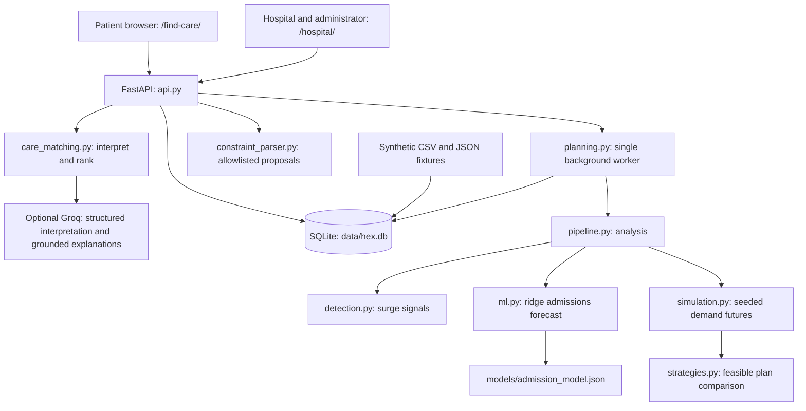
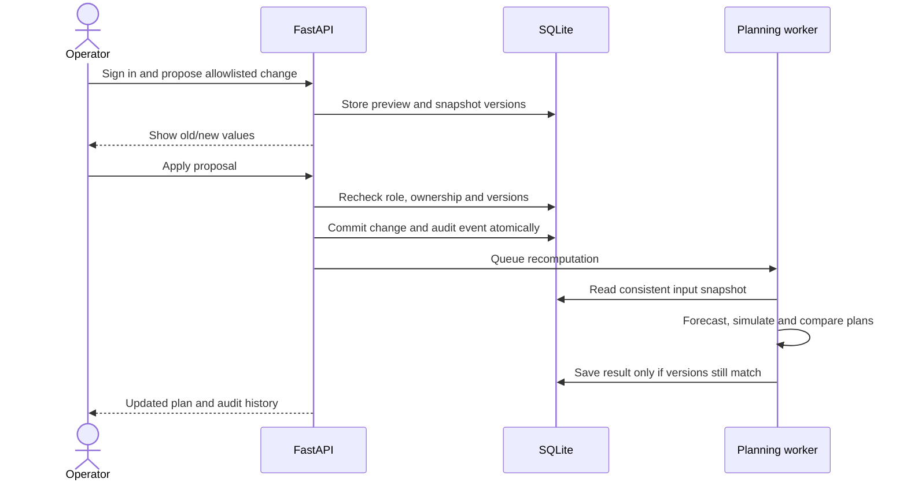

# HEX technical design

## Scope and supported runtime

HEX is a localhost hospital-network prototype with two journeys: public care navigation and authenticated hospital operations. A network administrator uses the same operations interface with broader permissions. All facility, distance and case data is synthetic. Care matching is navigation support, not diagnosis; capacity plans are illustrative decision support.

The supported launcher is `scripts/start.py`, using Python 3.10+, FastAPI, Uvicorn and SQLite. The interface is HTML/CSS/JavaScript served by FastAPI. Historical Vite and privacy-server prototypes are not part of this runtime. Setup, demo accounts and optional Groq configuration are in the [README](../README.md).

## Component architecture



## Patient request flow

1. The browser collects a concern, symptoms, requested services/resources and an area. A local-only preview checks emergency cues before the final request.
2. `POST /api/public/recommendations` validates the request and reads hospital reports. Free text is interpreted locally, or with optional Groq when the visitor explicitly enables it.
3. Matching checks reported services, requested specialties/resources, freshness and accepting status, then uses synthetic distance to rank suitable facilities. Operational and capability reports expire after 15 minutes.
4. Results explain inclusion/exclusion and distinguish missing data, stale reports, unavailable requirements and unclear requests. Emergency cues bypass ordinary matching and provider calls.
5. The browser refreshes options locally every five seconds without further Groq requests. Public searches are not persisted as case signals.

Groq receives submitted text/tags only when enabled. Structured outputs restrict extraction; inferred hard requirements require confirmation. Explanations select server-verified sentence IDs rather than inventing clinical claims. Provider errors fall back to local behavior. The integration has timeouts, output bounds and a shared rate limit.

## Hospital reporting and planning flow

Hospital operators update their own operational status, expertise/resources and planning limits. The administrator can change network budgets, scenario count, horizon and synthetic feeds. Reporting availability and planning additional beds are separate: a proposed plan never publishes extra beds as operational capacity.



Direct reporting forms also enforce ownership and validation. Frequent planning changes coalesce on a single worker; superseded computations cannot overwrite current results. Planning failures are exposed in plan state and do not prevent public availability reads.

## Data and model design

SQLite stores facilities, status, capability reports, hospital constraints, network settings, case signals, sessions, proposals, audit events and versioned plan results. See [data schema and fixture inventory](data-schema.md). The selected case feed is distinct from public searches and current hospital availability.

The pure-Python ridge autoregression uses prior admissions, lagged respiratory share and weekday to forecast admissions. Training/validation/test splits are chronological, with additional unseen cities held out; scaling is learned on training data. The checked-in synthetic benchmark has 26,028 hospital-day rows. Evaluation and split metadata are in `models/evaluation.json`; reproduce with `.venv/bin/python -m src.hex.ml`.

Forecasts initialize seeded demand futures. The engine compares baseline, fixed flex-bed allocation and constrained redistribution on the same futures, enforcing bed limits, transfer capacity and budget. Plans are ranked by worst-case unmet bed-days, then mean unmet bed-days, then cost. Greedy allocation finds the best of the evaluated feasible plans; it does not establish a global optimum. See [model assumptions](model-assumptions.md).

## Access and deployment boundaries

Server-side authorization restricts hospital changes to the owning operator; network settings require the administrator role. Apply checks proposal ownership and snapshot versions. Credentials and sessions are handled by `db.py`; provider keys stay server-side and `.env` is Git-ignored. Demo credentials are intentionally documented for local evaluation.

The launcher binds to `127.0.0.1`. This prototype needs production identity/access management, secure deployment, verified facility feeds, measured routing and real-world clinical/operational validation before use with real patients. Synthetic benchmark accuracy does not establish real-hospital performance.

## Verification

Run the automated suite from the repository root:

```bash
PYTHONPATH=src:. .venv/bin/python -m unittest discover -s tests -v
```

| Test file | Main coverage |
| --- | --- |
| `tests/test_api.py` | Routes, reporting, permissions, proposal preview/apply/audit, concurrency and failure isolation |
| `tests/test_care_matching.py` | Service matching, freshness, specialist/resource requirements, emergency bypass and fallback |
| `tests/test_groq.py` | Structured provider behavior and bounded integration |
| `tests/test_ml.py` | Reproducible model and holdout evaluation |
| `tests/test_engine.py` | Capacity/budget/transfer constraints and scenario behavior |

For browser demonstration, follow [the demo checklist](demo-checklist.md). External Groq credentials are optional; ordinary local care matching and planning work without them.
